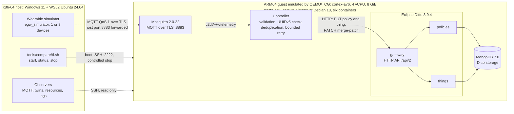

# EGW — Digital Twin Edge Gateway

EGW is an edge gateway for the Consumer-Controlled Digital Twin Architecture (C2DTA). It receives
telemetry from wearable devices over MQTT and keeps one digital twin per device in Eclipse Ditto, on
the gateway itself. This repository holds the gateway built and evaluated for a master's dissertation
at ISCTE-IUL (Theme 1, C2DTA).

> Every measured figure in this repository comes from an ARM64 guest emulated by QEMU/TCG on an x86-64 host.
> Nothing was run on a physical ARM board or on a native ARM64 machine.

## What this repository contributes

- **A gateway image.** A Yocto Project image (Poky 5.0.19 Scarthgap, `MACHINE=qemuarm64`,
  `egw-gateway-image`) with systemd and Docker that runs the gateway as six containers.
- **The controller** ([`src/egw_controller`](src/egw_controller/)), the gateway's own service: it turns
  MQTT telemetry into Ditto twin updates.
- **The contracts**: [`src/CONTRACTS.md`](src/CONTRACTS.md) (v1.2), JSON Schemas for the envelope and
  three wearables, and W3C WoT Thing Descriptions.
- **A deterministic wearable simulator** ([`src/egw_simulator`](src/egw_simulator/)): smartwatch, smart
  ring and smart clothing, with six scenarios from `smoke` to `soak`.
- **Lifecycle and measurement tooling** ([`tools/compare`](tools/compare/README.md)): one command each to
  start, query and stop the gateway under QEMU/TCG, for the Yocto image or for Debian 13 with the same
  stack, and the scripts that measured one against the other.
- **Evidence** under `docs/evidence/`: the functional runs, sealed with SHA-256 manifests, and the
  comparison's summary table and plan (its raw records are sealed in a local package; see
  [docs/results.md](docs/results.md)).

## Architecture



The simulator runs on the host; the six containers run inside the guest. Only MQTT (8883) and SSH (2222)
are forwarded from the host; the Ditto API and the controller API listen on the guest's loopback. The
4 vCPU and 8 GiB are emulator settings, not a physical gateway. Components, ports, the path of one
message and the code map are in [docs/architecture.md](docs/architecture.md).

## Implemented features

| Area | What exists |
|---|---|
| Telemetry ingress | MQTT over TLS on port 8883, username and password, a per-identity ACL, QoS 1 |
| Processing | JSON Schema validation (draft 2020-12), topic and payload identity checks, the `message_id` recomputed as a UUIDv5, deduplication kept in the twin, one outcome per message (`accepted`, `rejected`, `duplicate`, `failed`) |
| Twins | First contact creates one Ditto policy and one thing per device (`org.c2dta:<device-uuid>`); each message is a merge-patch; bounded retry on timeout, connection error and 5xx |
| Delivery | Persistent MQTT session; the PUBACK is requested only after the outcome is written, so the broker resends anything not acknowledged ([ADR 0011](docs/adr/0011-controller-restart-recovery.md)) |
| Storage | Eclipse Ditto 3.9.4 core services (gateway, policies, things) on MongoDB 7.0.39 |
| Operation | Health, readiness and metrics endpoints on the controller; the five registry images pinned by digest; controlled power-off |
| Environments | `yocto` and `debian13`, measured; `yoctowrynose` (Yocto 6.0.3, UEFI disk), demonstration only and not measured |

## Scope actually evaluated

- **G1, 2026-08-14.** The base image (`egw-image`) built from a clean checkout and booted five times
  under strict checks. Functional platform layer only.
- **G2, 2026-09-21.** One smartwatch flow, MQTT/TLS to controller to Ditto to API, and twin persistence
  across one whole-stack restart. Bounded functional scope.
- **G3, 2026-10-07.** The functional battery T1–T9, accepted by the student as the functional P0 freeze
  on the emulated candidate. It ran in sessions S1–S4 (2026-10-02 to 2026-10-07); T6 passed under its
  criterion amended on 2026-10-05. The families: T1 smokes and harness, T2 three wearables, T3 invalid
  payloads, T4 replay and sequence reset, T5 dropout and reconnection, T6 controller restart, T7 MongoDB
  and Ditto faults, T8 guest reboot, T9 TLS and authorisation.
- **Comparison a02, 2026-10-18/19.** The Yocto image against Debian 13 under one QEMU/TCG profile
  (`-cpu cortex-a76 -smp 4 -m 8192`): six valid executions in three pairs, each under the inherited
  `nominal` load (600 s at 11.2 msg/s). Exploratory, n = 3 per scenario. In the conditions tried, the
  Yocto configuration started faster, used less memory and disk and showed a higher observed acceptance
  rate.

Not evaluated: G4 to G7 are not decided, no pilot result is cited and the 95-run campaign was never
executed; no physical or native ARM64 platform; the `yoctowrynose` scenario. Formal gate outcomes are
recorded only in the [gate decision log](docs/governance/gate_decision_log.md). Figures, sources and
data: [docs/results.md](docs/results.md).

## Three paths

| To… | Start at | What it covers |
|---|---|---|
| **Demonstrate** | [docs/demo.md](docs/demo.md) | One-time preparation; start Yocto or Debian 13, one at a time; simulate one or three wearables; watch MQTT telemetry, the twins in Ditto, CPU, memory, disk and logs; stop the simulator and power the guest off |
| **Browse the code** | [docs/architecture.md](docs/architecture.md) | Components, communication, ports, the path of one message and a code map by directory |
| **Verify the results** | [docs/results.md](docs/results.md), then [docs/reproduce.md](docs/reproduce.md) | Each result with its table, data and analysis code, and what is held locally only; the environment, the image build and how to reproduce the analysis |

After the preparation in [docs/demo.md](docs/demo.md), from a clone on the WSL2 file system in a login
shell, one guest at a time:

```bash
bash tools/compare/tf.sh yocto apply     # boot, start the six containers, wait until ready; stays running
bash tools/compare/tf.sh yocto status    # live state as one JSON object
bash tools/compare/tf.sh yocto stop      # stop the stack, power the guest off; disks and logs kept
```

## Main limitations

- **Emulation only.** QEMU 8.2.7 TCG on an x86-64 host, with the load generator on the same host. There
  is no run on a physical SoC, on native ARM64 or under KVM. Timing, throughput and resource figures
  describe that emulated configuration only; they are not native ARM capacity, physical-device latency
  or energy figures.
- **Timed delivery at 11.2 msg/s was not sustained under TCG.** The two 600 s runs of G3 (T1 harness
  and T6) did not confirm every message by its deadline, the two 300 s T7 fault rows left a large
  late backlog, and in every a02 execution the observed acceptance rate stayed below the load
  published; the 30–180 s rows were in time. The 11.2 msg/s is an inherited experimental load, not a
  requirement.
- **Small, exploratory comparison.** n = 3 per scenario, no statistical significance, no maximum
  capacity, and no isolated effect of the distribution: the two configurations differ in kernel,
  container runtime and userland.
- **Consumer control is minimal.** The gateway creates one Ditto policy per device on first contact.
  The C2DTA consumer agents, DIDs and verifiable credentials, DIDComm, ledgers and decentralised storage
  are not implemented ([traceability](docs/academic/c2dta_p0_traceability.md)).
- **Some data are local only.** The a02 raw records, some analysis and plotting scripts and the newest
  unit-test seal are held outside the repository; [docs/results.md](docs/results.md) marks each one.
- **`yoctowrynose` is not measured.** It is an additional scenario for demonstration and functional
  use; its image was built outside this repository.

## Dissertation

- The current manuscript is the student's Word file, kept outside this repository; it is neither
  published nor replaced here.
- [`thesis/`](thesis/README.md) holds a historical LaTeX conversion of 2026-09-17 (Chapters 1–2
  imported, Chapters 3–6 headings only) and the records of the research protocol. It is not the
  current dissertation.
- The AI-use declaration is part of the dissertation, not of this repository. [`ai/`](ai/) keeps the
  prompt kits adapted from the C2DTA student repository template.

## History

Plans, gate decisions, proposals, reviews, past runbooks, the work log and the previous front page are
indexed in [docs/history/README.md](docs/history/README.md). They are records; their recorded content
is kept, and a few carry a dated status note at the top.
The full documentation index is [docs/README.md](docs/README.md).

## Repository layout

```
./
├─ src/                  # the gateway: controller, simulator, harness, deployment, Yocto layer, tests
│  ├─ CONTRACTS.md       # normative interfaces (topics, envelope, twins, ports), v1.2
│  ├─ egw_controller/    # MQTT-to-Ditto bridge
│  ├─ egw_simulator/     # wearable simulator (3 wearables, 6 scenarios)
│  ├─ egw_experiments/   # experiment harness and analysis
│  ├─ deployment/        # Compose stack: Mosquitto, Ditto, MongoDB, controller
│  ├─ yocto/             # kas manifests and the meta-egw layer
│  ├─ schemas/ things/   # JSON Schemas and WoT Thing Descriptions
│  └─ tests/             # broker-free unit tests (pytest)
├─ tools/                # compare/ (lifecycle, comparison), demo/ (demonstration wrappers),
│                        # session/ and probe/ (past sessions, diagnostics), ci/, test/
├─ docs/                 # the five guides, evidence capsules, ADRs, governance, setup, reviews, history
├─ experiments/          # harness results tree and the G4 pilot plan
├─ diagrams/             # Mermaid and PlantUML diagrams
├─ thesis/               # historical LaTeX conversion and research-protocol records
├─ paper/                # IEEE article, deferred
├─ ai/                   # prompt kits
├─ PROGRESS.md           # dated state records (history; current state: this page and docs/)
└─ LOG.md                # work diary
```

## Rules of this repository

- Work lands on `dev` through pull requests; `main` receives stable versions only
  ([CONTRIBUTING.md](CONTRIBUTING.md)).
- Nothing is declared done without verifiable evidence (commit, log, test or data).
- Sealed evidence under `docs/evidence/` is never edited; failed attempts and negative results are kept.
  `experiments/results/raw/` becomes immutable at the data freeze (`data-v1`), which has not occurred.
- No quantitative figure enters the dissertation without raw data, a manifest and an analysis script.
- Evidence from the emulated guest is functional; its timing, throughput and resource figures are
  informational, labelled emulated and describe that configuration only. Any future native or
  hardware-accelerated ARM64 guest is a distinct environment with its own recorded provenance.
- Secrets never enter Git; [`src/deployment/.env.example`](src/deployment/.env.example) is the template.
- British English is the working language
  ([language policy](docs/governance/language-policy.md)); the Portuguese Resumo and external
  administrative drafts are the exceptions.
