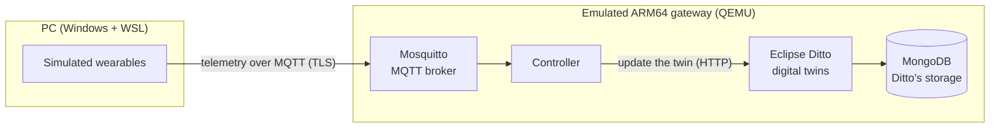

# EGW: Digital Twin Edge Gateway

## Project overview

EGW is an edge gateway for wearable devices. It receives the data that a wearable sends (for example heart
rate or temperature) and keeps an up-to-date digital copy of each device, called a **digital twin**. The
gateway runs on a small Linux system built with the Yocto Project, close to the devices, instead of in
the cloud.

The work is part of a master's dissertation at Iscte (Lisbon) on the Consumer-Controlled Digital Twin
Architecture (C2DTA). This repository holds the gateway, the simulated devices, the tools to run them and
the recorded results.

> The gateway always ran on an ARM64 computer **emulated** by QEMU on an ordinary PC, with the simulated
> devices on the same PC. Nothing was run on a physical board.

## How it works



1. The simulated wearables send telemetry over MQTT, encrypted with TLS, to the **Mosquitto** broker.
2. The **controller** reads each message, checks it, ignores repeated messages and updates the device's
   twin.
3. **Eclipse Ditto** holds one twin per device. **MongoDB** is where Ditto stores the twins; it does not
   carry the messages.

Mosquitto, the controller, MongoDB and three Ditto services run as six containers inside the emulated
gateway. Main versions: Yocto Project 5.0 (Scarthgap), Eclipse Ditto 3.9.4, Mosquitto 2.0.22,
MongoDB 7.0 and QEMU 8.2.7. Details: [docs/architecture.md](docs/architecture.md).

## Before you start

The commands below need a prepared computer. Cloning the repository is not enough: the gateway images
and some settings are created once and kept outside the repository.

**One-time preparation** (described in [docs/demo.md](docs/demo.md), section 1):

- Windows with WSL2 (Ubuntu 24.04);
- the gateway image built with Yocto, and the Debian 13 image if you want to compare;
- QEMU, Terraform and a Python environment with the device simulator;
- the SSH key of the gateway user and a local configuration file with the passwords (never stored in Git);
- the controller's container image.

**On another PC**, one script does all of this from the *demonstration kit*, a ZIP with the gateway image
and the controller's container image that the author provides. In an Ubuntu (WSL) terminal, from the root
of the repository clone:

```bash
bash tools/setup/prepare_demo_host.sh --kit <path to egw-demo-kit-<date>.zip>
```

It installs what is missing, creates new passwords and prepares Debian 13. It took about 10 minutes on the
PC where it was tested, and it can be run again safely. What the PC needs, and what the script does:
[tools/setup/README.md](tools/setup/README.md).

**Every time:**

- open a WSL terminal (`bash -l`) and go to the root of the repository clone;
- run **only one environment at a time** (Yocto or Debian 13).

## Start with the menu

The simplest way:

```bash
bash tools/demo/demo.sh
```

1. Choose **1** (Yocto) or **2** (Debian 13) to start the gateway.
2. Wait until it prints `ENVIRONMENT READY` (a few minutes; the first start takes longer).
3. Choose **4** for one wearable or **5** for three types of wearable. The simulation stops by itself after
   60 seconds.
4. Choose **6** to see the twins.
5. Choose **8** and answer `y` to power the gateway off.

The menu prints each command it runs. It does not open the observation terminals of the next section;
open them yourself if you want them. Leaving the menu (**0**) does **not** power the gateway off; only
option **8** does.

## Run the demonstration manually

Each step is one command. Use a separate WSL terminal for each terminal number.

**Terminal 1: start the gateway**

```bash
bash tools/compare/tf.sh yocto apply
```

Wait for the line `ENVIRONMENT READY`. The command then ends, but the gateway keeps running. Check its
state at any time:

```bash
bash tools/compare/tf.sh yocto status
```

**Terminals 2, 3 and 4: open the observers** (each one runs until you press Ctrl+C)

```bash
bash tools/demo/observe/mqtt.sh yocto
```

```bash
bash tools/demo/observe/ditto.sh yocto
```

```bash
bash tools/demo/observe/resources.sh yocto
```

**Terminal 5: start the simulated devices** (choose one)

One smartwatch:

```bash
bash tools/demo/wearables/simulate.sh yocto 1
```

Three types of wearable (smartwatch, smart ring and smart clothing):

```bash
bash tools/demo/wearables/simulate.sh yocto 3
```

The simulation ends by itself after 60 seconds.

**Look at the twins once** (any terminal)

```bash
bash tools/demo/observe/ditto.sh yocto 5 once
```

**Finish**

If the simulation is still running:

```bash
bash tools/demo/wearables/stop.sh
```

Close the observers with Ctrl+C, then power the gateway off and check that it is off:

```bash
bash tools/compare/tf.sh yocto stop
```

```bash
bash tools/compare/tf.sh yocto status
```

To use Debian 13, power the running gateway off first, then repeat the same commands with `debian13` in
place of `yocto`.

### What each terminal shows

| Terminal | View | What you can see |
|---|---|---|
| 5 | Simulator | The messages the simulated devices send |
| 2 | MQTT | The messages the broker receives |
| 3 | Ditto | The state of each twin, and whether the current simulation updated it |
| 4 | Resources | CPU, memory and disk use of the gateway and its containers |
| 1 | Environment status | Whether the gateway is running |

A message seen in the MQTT view has reached the broker; it does not yet prove that the twin changed. The
Ditto view proves that: every few seconds it reads the twins and marks the ones updated by the current
simulation. It is a repeated query, not a live stream of events.

More options (other durations, the service logs, an additional Yocto scenario):
[docs/demo.md](docs/demo.md).

## What was implemented and evaluated

1. **Building and starting the Yocto image.** The base image was built from scratch and started five times
   in a row, passing automatic checks each time; the gateway image, which adds the container platform, was
   then built and started in QEMU.
2. **Integrating the services.** The broker, the controller, Ditto and MongoDB run together inside the
   image.
3. **Simulated devices.** A smartwatch, a smart ring and a smart clothing item, each sending its own kind
   of data.
4. **From telemetry to twin.** Messages from one device, then from three device types at once, reached
   their twins.
5. **Tests of the main behaviours.** Invalid messages are rejected without changing the twin; repeated
   messages are ignored; the gateway recovers after a network drop, a controller restart, a database or
   twin-service failure and a reboot of the gateway, and the twins survive the reboot. A device that does
   not trust the broker's certificate cannot connect; the broker refuses a wrong password, an unencrypted
   connection and anonymous clients; and a client without permission received nothing from a topic it may
   not read.
6. **An exploratory comparison of Yocto and Debian 13.** The same services ran on both systems with the same
   emulator settings, three times each.

## Results and limitations

- **Emulation only.** All figures describe an emulated ARM64 computer on a PC. They say nothing about speed,
  capacity or energy on real hardware.
- **Timing under load.** In every 10-minute run at the test load (11.2 messages per second), on Yocto and
  on Debian 13, the emulated gateway fell behind: many messages were not confirmed within the time limit
  (60 s after the load ended). Runs of 30 to 180 s at the same load were in time.
- **Recovery has costs.** While the database or the twin service was down, some messages failed and were
  never applied. After the controller restart every message was applied once, but many late; that test
  did not judge delivery time.
- **A limited comparison.** In three runs each, the Yocto configuration started faster and used less memory
  and disk than Debian 13. This holds for the configurations tried, not for Yocto and Debian in general.
- **Consumer control is mostly not implemented.** The gateway gives each device a basic access policy. The
  other parts of C2DTA (consumer agents, decentralised identities, verifiable credentials and a ledger)
  are outside this implementation.

Every result, with its data and the code that analysed it: [docs/results.md](docs/results.md).

## Code and documentation

| Folder or file | What it holds |
|---|---|
| [`src/egw_controller/`](src/egw_controller/) | The controller: from MQTT messages to twin updates |
| [`src/egw_simulator/`](src/egw_simulator/) | The simulated wearables |
| [`src/deployment/`](src/deployment/) | The six containers and their configuration |
| [`src/yocto/`](src/yocto/) | The Yocto layer and build files of the gateway image |
| [`src/CONTRACTS.md`](src/CONTRACTS.md) | Message formats, topics and interfaces |
| [`tools/compare/`](tools/compare/README.md) | Start, check and power off the gateway; the comparison measurements |
| [`tools/demo/`](tools/demo/README.md) | The menu, the device simulation and the observers |
| [`tools/setup/`](tools/setup/README.md) | Preparing another PC for the demonstration from the kit |
| [`docs/architecture.md`](docs/architecture.md) | How the parts fit together, and a map of the code |
| [`docs/demo.md`](docs/demo.md) | The full demonstration guide, including the one-time preparation |
| [`docs/results.md`](docs/results.md) | The results, their data and their analysis code |
| [`docs/reproduce.md`](docs/reproduce.md) | How to rebuild the image and repeat the measurements |
| [`docs/evidence/`](docs/evidence/) | The original recorded data, kept unchanged |

How to contribute: [CONTRIBUTING.md](CONTRIBUTING.md). Full documentation index: [docs/README.md](docs/README.md).
