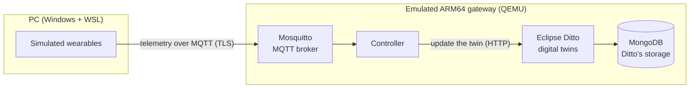

# EGW: Digital Twin Edge Gateway

## Project overview

EGW is an edge gateway for wearable devices. It receives the data that a wearable sends (for example heart
rate or temperature) and keeps an up-to-date digital copy of each device, called a **digital twin**. The
gateway runs on a small Linux system built with the Yocto Project, close to the devices, instead of in
the cloud. The work is part of a master's dissertation at Iscte (Lisbon) on the Consumer-Controlled
Digital Twin Architecture (C2DTA).

**What was implemented**

- A Yocto Project 5.0 (Scarthgap) gateway image for an ARM64 computer, with a container platform.
- Six services inside the gateway: the Mosquitto MQTT broker, the controller, three Eclipse Ditto services
  and MongoDB.
- Simulated wearables: a smartwatch, a smart ring and a smart clothing item, each sending its own data.
- Tests of the main behaviours: wearable-to-twin integration (one device, then three device types),
  rejection of invalid messages, handling of repeated messages, recovery after disconnection, recovery
  after a database or twin-service failure, controller restart, persistence of the twins across a gateway
  reboot, and the broker's security checks (certificates, passwords, access control).
- An exploratory Yocto–Debian comparison: the same services on the Yocto image and on Debian 13, under the
  same emulator settings.

**Scope**

- The gateway always ran on an ARM64 computer **emulated** by QEMU (TCG mode) on an ordinary PC, with the
  simulated devices on the same PC. Nothing was run on a physical board.
- Only the gateway's local services were implemented, not the full C2DTA architecture.

## Architecture



| Component | Role |
|---|---|
| Simulated wearables | Send telemetry over MQTT, encrypted with TLS |
| Mosquitto (MQTT) | **Carries the messages** from the wearables to the gateway |
| Controller | Reads each message, checks it, ignores repeated messages and updates the device's twin |
| Eclipse Ditto | **Keeps the state** of each digital twin, one twin per device |
| MongoDB | **Gives persistence**: Ditto stores the twins in it; it does not carry the messages |

The six services run as containers inside the emulated gateway. Main versions: Yocto Project 5.0
(Scarthgap), Eclipse Ditto 3.9.4, Mosquitto 2.0.22 and MongoDB 7.0. Details and a map of the code:
[docs/architecture.md](docs/architecture.md).

## Requirements and setup

Every command in this README runs in a WSL (Ubuntu) terminal, from the root of the repository clone.

**On a PC that is already prepared**

- Open a WSL login terminal (`bash -l`) and go to the root of the clone.
- Run only **one environment at a time** (Yocto or Debian 13).

**On a new PC**

Cloning the repository is not enough. The gateway image and some settings are created once and kept
outside the repository. A new PC needs:

- Windows 10 or 11 with WSL 2 and Ubuntu 24.04 (`wsl --install -d Ubuntu-24.04` in a PowerShell opened as
  administrator), with hardware virtualisation turned on;
- 16 GB of RAM, with at least 12 GB given to WSL (`%UserProfile%\.wslconfig`), about 25 GB of free disk and
  internet access during the preparation;
- the repository cloned **inside Ubuntu**, on the Linux file system (for example
  `git clone <repository URL> ~/egw`), not under `/mnt/c` and not with Git for Windows: the preparation
  script refuses both;
- the **demonstration kit**: a ZIP of about 180 MB with the gateway image and the controller's container
  image, plus its `.sha256` checksum file. The kit is not in the repository. It is shared by the author
  on request; ask the repository owner, [@Ruisth](https://github.com/Ruisth). Keep the `.sha256` file next
  to the ZIP.

Then, in the clone (about 10 minutes; it can be run again safely):

```bash
bash tools/setup/prepare_demo_host.sh --kit <path>/egw-demo-kit-<date>.zip
```

Open a new WSL terminal afterwards, so that the settings apply. What the script does, step by step:
[tools/setup/README.md](tools/setup/README.md).

**Demonstration or reproduction?** A PC prepared with the kit runs the **demonstration**. The kit holds a
sanitised copy of the gateway image (no passwords, keys or records, so its checksum differs from the
measured image), and the PC uses Ubuntu's QEMU 8.2.x. It does not reproduce the recorded measurements,
which used the original image and QEMU 8.2.7 from the Yocto build: see [docs/reproduce.md](docs/reproduce.md).

## Run the demonstration

**With the menu**

```bash
bash tools/demo/demo.sh
```

Choose **1** (Yocto) or **2** (Debian 13) to start the gateway, **4** or **5** to simulate one wearable or
three, **6** to see the twins, and **8** (then `y`) to power the gateway off. Leaving the menu with **0**
does **not** power the gateway off; only option **8** does. The menu prints each command it runs.

**With independent commands**

Use a separate WSL terminal for each step that keeps running.

1. Start the gateway and check its state. Wait for the line `ENVIRONMENT READY` before simulating any
   wearable (a few minutes; the first start of each system takes longer). The command then ends, but the
   gateway keeps running.

   ```bash
   bash tools/compare/tf.sh yocto apply
   bash tools/compare/tf.sh yocto status
   ```

2. Open the observers, each in its own terminal. Each runs until you press **Ctrl+C**.

   ```bash
   bash tools/demo/observe/mqtt.sh yocto
   ```

   ```bash
   bash tools/demo/observe/ditto.sh yocto
   ```

   ```bash
   bash tools/demo/observe/resources.sh yocto
   ```

3. Start the simulated wearables, choosing one of the two (the simulation stops by itself after
   60 seconds):

   ```bash
   bash tools/demo/wearables/simulate.sh yocto 1   # one smartwatch
   ```

   ```bash
   bash tools/demo/wearables/simulate.sh yocto 3   # smartwatch, smart ring and smart clothing
   ```

4. Look at the twins once more, then close: stop the simulation if it is still running, close the
   observers with Ctrl+C, power the gateway off and check that it is off.

   ```bash
   bash tools/demo/observe/ditto.sh yocto 5 once
   bash tools/demo/wearables/stop.sh
   bash tools/compare/tf.sh yocto stop
   bash tools/compare/tf.sh yocto status
   ```

Notes:

- Only one environment can be running. To use Debian 13, power the running gateway off first, then use
  the same commands with `debian13` in place of `yocto`.
- `tf.sh ... stop` is the normal power-off: it keeps the disks, so the twins are still there at the next
  start. `tf.sh ... destroy` is **not** an equivalent: it deletes the work disks, and the next start sets
  everything up again.

| View | What you can see |
|---|---|
| Simulator | The messages the simulated wearables send |
| MQTT observer | The messages the broker receives |
| Ditto observer | The state of each twin, and whether the current simulation updated it |
| Resources observer | CPU, memory and disk use of the gateway and its containers |
| `tf.sh ... status` | Whether the gateway is running |

A message seen in the MQTT view has reached the broker; it does not yet prove that the twin changed. The
Ditto view proves that: every few seconds it reads the twins and marks the ones updated by the current
simulation. More options (other durations, the service logs, an additional Yocto scenario):
[docs/demo.md](docs/demo.md).

## Results and limitations

- **Behaviour.** In emulation, telemetry from one wearable and then from three wearable types reached
  their twins; invalid messages were rejected and repeated ones ignored; the gateway recovered after a
  network drop, a controller restart, a database or twin-service failure and a reboot, and the twins
  survived the reboot. A device that did not trust the broker's certificate could not connect; the broker
  refused a wrong password, an unencrypted connection and anonymous clients; and a client without
  permission received nothing from a topic it may not read.
- **Timing under load.** In every 10-minute run at the test load of 11.2 messages per second, on Yocto and
  on Debian 13, the emulated gateway fell behind: many messages were not confirmed within the time limit.
  Runs of 30 to 180 s at the same load were in time.
- **Recovery has costs.** While the database or the twin service was down, some messages failed and were
  never applied. After the controller restart every message was applied once, but many late.
- **Comparison.** In three runs each, the Yocto configuration started faster and used less memory and
  disk than Debian 13.

Limitations:

- The evaluation ran in **QEMU/TCG emulation**, not on physical SoC hardware; it says nothing about speed,
  capacity or energy on a real board.
- The Yocto–Debian comparison is **exploratory**: it holds for the configurations tried, not for Yocto and
  Debian in general.
- The message rates are **experimental parameters** offered to the gateway, not requirements and not a
  demonstrated maximum capacity.
- The gateway's **local services** were implemented, not the full C2DTA architecture (consumer agents,
  decentralised identities, verifiable credentials and a ledger).

Every result, with its data and the code that analysed it: [docs/results.md](docs/results.md).

## Repository structure

| Folder | What it holds |
|---|---|
| [`src/`](src/) | The controller, the wearable simulator, the message contracts, the deployment of the six services, the Yocto layer and the tests |
| [`tools/`](tools/) | Preparation of a new PC (`setup/`), start and power-off with Terraform and the comparison (`compare/`), the demonstration and observers (`demo/`), and the tools the measurements used (`session/`) |
| [`experiments/`](experiments/) | Experiment configurations and plans |
| [`diagrams/`](diagrams/README.md) | Earlier diagrams and the C2DTA reference drawing; the current architecture is in [docs/architecture.md](docs/architecture.md) |
| [`docs/`](docs/README.md) | The guides: [architecture](docs/architecture.md), [demonstration](docs/demo.md), [results](docs/results.md) and [reproduction](docs/reproduce.md) |
| [`docs/evidence/`](docs/evidence/) | The original recorded data, sealed and kept unchanged; described in the [documentation index](docs/README.md#evidence) |
| [`docs/history/`](docs/history/README.md) | Project records: work log, progress record, reviews and other internal documents |
| [`thesis/`](thesis/README.md), [`paper/`](paper/README.md) | A historical LaTeX conversion of an early dissertation draft (17 September 2026) and a placeholder for a deferred article; the dissertation itself is a separate document |
