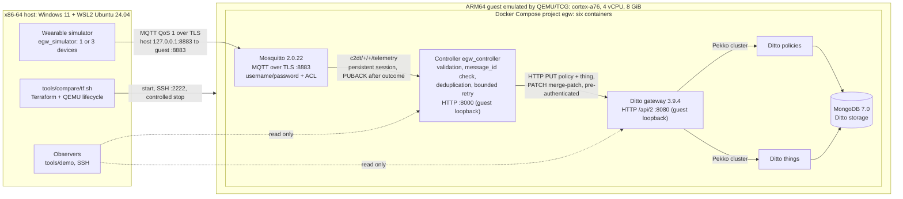
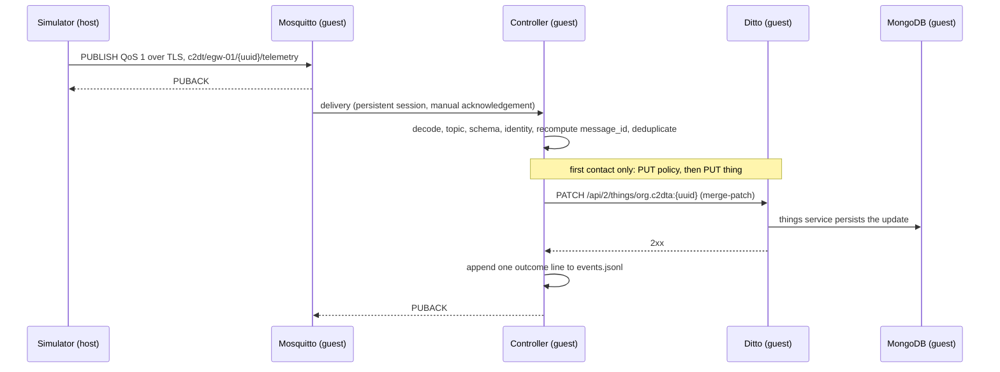

# Architecture

This page describes what was built. It covers the components, how they
communicate, where the boundary between host and guest lies, and where the
code is. Related pages:

- the normative interfaces: [`src/CONTRACTS.md`](../src/CONTRACTS.md) (v1.2, 2026-09-24);
- running the system: [`demo.md`](demo.md);
- results and their sources: [`results.md`](results.md);
- rebuilding and reproducing: [`reproduce.md`](reproduce.md);
- decisions and earlier designs: [`history/README.md`](history/README.md).

> Every figure in this repository comes from an ARM64 guest emulated by QEMU/TCG
> on an x86-64 host. The 4 vCPU and 8 GiB below are emulator settings, not the
> resources of a physical gateway. Memory limits and timeouts on this page are
> configuration values read from the code, not measurements.

## 1. Overview

The gateway receives telemetry from wearables over MQTT and keeps one digital
twin per device in Eclipse Ditto. Its own service is the **controller**, which
consumes MQTT and writes to Ditto. Everything runs as six containers inside one
ARM64 guest.

## 2. Host and guest

| Layer | What it is | Defined in |
|---|---|---|
| Host | x86-64 workstation, Windows 11 with WSL2 Ubuntu 24.04. It runs Terraform, QEMU, the simulator, the demonstration observers and the measurement harness. | [`tools/compare/README.md`](../tools/compare/README.md) §3 |
| Image preparation | Docker Desktop on Windows builds the controller image for `linux/arm64`. It is saved as an archive with an identity record and loaded into the guest. Nothing is built on the guest. | [`src/deployment/scripts/build-controller-image.sh`](../src/deployment/scripts/build-controller-image.sh), [`src/Dockerfile`](../src/Dockerfile) |
| Emulator | `qemu-system-aarch64` 8.2.7, taken from the Yocto build's `qemu-helper-native` sysroot. The profile is `-machine virt -accel tcg -cpu cortex-a76 -smp 4 -m 8192`. It is the same for every scenario and is never read from a scenario file. | [`tools/compare/lib.sh`](../tools/compare/lib.sh) |
| Guest network | QEMU user-mode networking. The host forwards only `127.0.0.1:2222` to guest port 22 (SSH) and `127.0.0.1:8883` to guest port 8883 (MQTT over TLS). | [`tools/compare/compare_env.sh`](../tools/compare/compare_env.sh) `qemu_argv` |
| Guest disks | The root disk is a qcow2 overlay on an immutable, checksummed base copy. The data disk is a raw 32 GiB ext4 disk labelled `egw-data`, mounted on `/var/lib/docker`. | `tools/compare/README.md` §2 and §6 |
| Guest control | Serial console to a log file, QEMU monitor on a Unix socket (fallback power-down) and a pid file. Only one guest runs at a time, enforced by a lock and a check for any other QEMU process. | `tools/compare/lib.sh`, `compare_env.sh` |

Guest operating systems (scenarios; files in
[`tools/compare/scenarios/`](../tools/compare/scenarios/)):

| Scenario | Operating system | Boot | Role |
|---|---|---|---|
| `yocto` | Poky 5.0.19 (Scarthgap), `egw-gateway-image`, `MACHINE=qemuarm64`. Kernel linux-yocto 6.6.142, systemd, BusyBox 1.36.1, docker-moby 25.0.9, Compose v2.26.0. Operator `egw` (uid 1000), key-only SSH. | Direct kernel boot | The project's image, built from [`src/yocto/`](../src/yocto/README.md). Measured in series a02. |
| `debian13` | Debian 13.8 genericcloud arm64 (20261017-2634). Kernel 6.12.113, docker.io 26.1.5, Compose 2.26.1. Provisioned once by cloud-init with the same configuration files. | Direct kernel boot of Debian's own kernel and initrd | Comparison baseline. Measured in series a02. |
| `yoctowrynose` | Poky 6.0.3 (Wrynose), `MACHINE=genericarm64`. Kernel 6.18.39 with initramfs, Docker 29.3.0, Compose 5.1.0. | UEFI: edk2 firmware, systemd-boot | **Additional scenario, not measured.** For demonstration and functional use only. It was built outside this repository; its kas manifest and layer are inside a sealed image package that is kept locally. |

The known differences between the scenarios are listed in each scenario file
and in `tools/compare/README.md` §6 and §11.

## 3. Services inside the guest

The services form the Docker Compose project `egw`
([`src/deployment/compose.yaml`](../src/deployment/compose.yaml)): six
containers on one bridge network, `egw-net`. The five external images are
pinned by digest in
[`images.lock.env`](../src/deployment/images.lock.env). The controller image
is built locally (`pull_policy: never`).

| Service | Image | Exposure | Memory limit | Role |
|---|---|---|---|---|
| `mosquitto` | `eclipse-mosquitto:2.0.22` | `8883`, published on the guest. The host reaches it through the QEMU forward on `127.0.0.1:8883`. | 128M | MQTT broker: one TLS 1.2 listener with server authentication only, no anonymous access, password file and ACL, persistent volume |
| `controller` | `egw-controller:0.1.0` from [`src/Dockerfile`](../src/Dockerfile) (`python:3.12.13-slim`, hashed dependency lock) | `127.0.0.1:8000`, guest loopback only | 256M | The MQTT-to-Ditto bridge: the gateway's own service |
| `ditto-gateway` | `eclipse/ditto-gateway:3.9.4` | `127.0.0.1:8080`, guest loopback only | 768M | Ditto HTTP API `/api/2`, with pre-authentication enabled |
| `ditto-things` | `eclipse/ditto-things:3.9.4` | none | 768M | Twins (things) |
| `ditto-policies` | `eclipse/ditto-policies:3.9.4` | none | 768M | Twin policies |
| `mongodb` | `mongo:7.0.39` | none | 512M | Storage of Ditto's things and policies |

- The three Ditto services form a Pekko cluster through the DNS alias
  `ditto-cluster`. Only Ditto's core services are deployed. Search,
  connectivity, the UI and nginx are not ([`CONTRACTS.md`](../src/CONTRACTS.md) §8).
- The limits add up to 3,200 MiB of the guest's 8 GiB. The header comment of
  `compose.yaml` still gives an earlier budget of 2,432 MiB, from when each
  Ditto service had 512M.
- On the guest, the deployment lives in `/opt/egw/deployment`. The controller's
  event log is bind-mounted from `./data/events` to `/data/events`.

## 4. The message path

The path is simulator → MQTT/Mosquitto → controller → Ditto, with MongoDB as
Ditto's storage.

1. **Simulator, on the host** ([`src/egw_simulator/`](../src/egw_simulator/README.md)).
   - Publishes with paho-mqtt 2.x at QoS 1, over TLS with server
     authentication. It trusts the broker's CA, which is copied to the host at
     provisioning, and logs in as user `egw-simulator`.
   - The topic is `c2dt/{egw_id}/{device_uuid}/telemetry`. Every payload is
     validated against the JSON Schemas before it is published.
   - `message_id` is a UUID v5 of `run_id:device_uuid:seq` under the project
     namespace.
   - There are three device profiles: smartwatch, smart ring and smart
     clothing. An aggregate rate is split between them in the ratio
     1 : 0.2 : 10.
2. **Mosquitto.** The ACL
   ([`mosquitto/config/acl`](../src/deployment/mosquitto/config/acl)) lets
   `egw-simulator` only write `c2dt/#` and `egw-controller` only read it.
   The window and queue settings are in `CONTRACTS.md` §1.
3. **Controller** ([`src/egw_controller/`](../src/egw_controller/README.md)), in the guest.
   - It subscribes to `c2dt/+/+/telemetry` at QoS 1, with a persistent session
     (`clean_session=False`), client id `egw-controller-{EGW_ID}` and manual
     acknowledgement. It is ready only after a QoS 1 SUBACK.
   - Deliveries enter a queue of 10,000 with a single consumer. The pipeline
     runs in this order:
     1. JSON decode;
     2. topic parse;
     3. JSON Schema validation (draft 2020-12);
     4. consistency between topic and payload;
     5. recomputation of `message_id` (a mismatch is `rejected`, with no Ditto call);
     6. device state seeded from the twin (on first contact, a `PUT` of the
        policy and then of the thing);
     7. deduplication: a per-device LRU of 1,024 `message_id`s, plus a `seq`
        floor per `run_id`, with the state kept in the twin's `ingestion`
        feature;
     8. a `PATCH` with `application/merge-patch+json`;
     9. one outcome line in `events.jsonl`.
   - The PUBACK is requested only after that line is written (ADR 0011).
   - Outcomes are `accepted`, `rejected`, `duplicate` and `failed`, with
     `dropped` and `processing_errors` counted apart.
   - Calls to Ditto are retried for timeouts, connection errors and 5xx only:
     3 attempts in total, with exponential back-off from 200 ms and a 10 s
     request timeout. A 4xx is never retried.
   - Latency is the controller's reception to Ditto's 2xx, both read on the
     controller's monotonic clock.
   - HTTP API: `GET /health`, `GET /ready`, `GET /twins/{device_id}` and
     `GET /metrics`. `/ready` returns 200 only with the QoS 1 subscription in
     place and Ditto reachable.
4. **Ditto.** The gateway passes requests to the things and policies services,
   which store the data in **MongoDB**. For each device,
   `thingId` = `policyId` = `org.c2dta:{device_uuid}`. Each twin has the
   features of its device type plus `ingestion` (`CONTRACTS.md` §4). The
   controller authenticates with the header
   `x-ditto-pre-authenticated: pre:egw-controller`, inside `egw-net` only.

## 5. Ports and operator access

| Endpoint | Listens on | Reached from the host by |
|---|---|---|
| SSH (22) | the guest | `127.0.0.1:2222` (QEMU forward), user `egw`, key only, with the scenario's own `known_hosts` |
| MQTT over TLS (8883) | `mosquitto`, published on the guest | `127.0.0.1:8883` (QEMU forward) |
| Controller HTTP (8000) | guest loopback | an SSH local forward (`tools/compare/functional_check.sh`, the measurement scripts), or `curl` run inside the guest over SSH (`tools/demo` observers) |
| Ditto HTTP (8080) | guest loopback | the same as the controller |
| MongoDB (27017), Ditto cluster and health (7626) | `egw-net` only | not reachable from the host |

No other port is opened. The lifecycle runs through
`tools/compare/tf.sh`:

- Terraform calls `compare_env.sh` (`prepare`, `start`, `status`, `stop`,
  `destroy`) and `up.sh`, which runs `provision_stack.sh`.
- The controlled stop runs `docker compose stop -t 60`, then `sudo poweroff`
  over SSH (the monitor's `system_powerdown` as a fallback). It then waits up to
  180 s for QEMU to end. QEMU is never killed.
- The `-t 60` is shorter than the controller's `stop_grace_period: 130s` in
  `compose.yaml`.

Details are in [`tools/compare/README.md`](../tools/compare/README.md) §0,
§4 and §5, and the steps are in [`demo.md`](demo.md).

## 6. Contracts

- [`src/CONTRACTS.md`](../src/CONTRACTS.md) **v1.2** is normative. It covers
  MQTT, the event envelope, the per-device measurements, the twins, the
  controller, the environment variables, the simulator's CLI, ports and the
  metric definitions.
- [`src/schemas/`](../src/schemas/) holds the envelope v1 schema and one
  schema per device (draft 2020-12). The controller and the simulator both load
  them at runtime.
- [`src/things/`](../src/things/) holds W3C WoT Thing Descriptions, one per
  wearable. They describe the devices but are not loaded at runtime; only
  `src/tests/test_things.py` checks them.
- [`docs/adr/`](adr/README.md) holds the decisions behind the design. ADR 0011
  (controller restart recovery) introduced the persistent session and the
  PUBACK after the outcome line in v1.2.
- Some older pages still cite CONTRACTS v1.1:
  [`src/egw_controller/README.md`](../src/egw_controller/README.md),
  [`src/egw_simulator/README.md`](../src/egw_simulator/README.md),
  [`diagrams/README.md`](../diagrams/README.md) and
  [`diagrams/architecture.md`](../diagrams/architecture.md). Where they
  differ, `CONTRACTS.md` v1.2 applies.
- [`src/deployment/README.md`](../src/deployment/README.md) was written for a
  native ARM64 VM that was never used for any result. The Compose stack it
  describes is the one deployed in the emulated guest.

## 7. Scope of the build

The gateway implements a bounded core (P0) of the edge-gateway functions of
the C2DTA reference architecture. That core is MQTT/TLS ingestion with
authentication and ACL, schema validation, deduplication, Ditto twins with a
policy each, and MongoDB storage.

The following are **not implemented**:

- self-sovereign identity and agent messaging (DIDs, verifiable credentials,
  DIDComm, ACA-Py);
- the ecosystem ledger (Hyperledger Fabric) and the identity ledger;
- decentralised storage of historical data (IPFS);
- owner-authorised onboarding of devices. The controller creates a policy and
  a thing on a device's first valid event;
- Ditto's search, connectivity and UI services.

The function-by-function mapping is in
[`docs/academic/c2dta_p0_traceability.md`](academic/c2dta_p0_traceability.md)
§1–2. Its status notes date from 2026-09-18. The five-layer reference drawing
is [`diagrams/c2dta_five_layer_reference.svg`](../diagrams/c2dta_five_layer_reference.svg),
which is non-normative.

## 8. Code map

| Directory | Responsibility | Key files |
|---|---|---|
| [`src/egw_controller/`](../src/egw_controller/) | MQTT-to-Ditto bridge, the gateway's own service | `mqtt.py` (session, manual acknowledgement), `service.py` (pipeline, `message_id` check, outcomes), `dedupe.py`, `ditto.py` (HTTP client, retry), `schema.py`, `topic.py`, `events.py`, `metrics.py`, `app.py` (HTTP API), `config.py` (`EGW_*`) |
| [`src/egw_simulator/`](../src/egw_simulator/) | Deterministic wearable simulator: 3 profiles, 6 scenarios | `cli.py`, `runner.py` (pacing), `publisher.py` (paho, TLS, QoS 1), `devices.py`, `profiles.py`, `envelope.py`, `scenarios.py`, `validation.py`, `output.py` |
| [`src/egw_experiments/`](../src/egw_experiments/) | Experiment harness and analysis (`python -m egw_experiments plan/run/analyze/...`) | Used by the comparison: `run.py`, `analyze.py`, `plan_gen.py`, `protocol.py`, `checksums.py`, `controller_metrics.py`, `environment.py`, `resources.py`. Earlier sessions: `campaign.py`, `proof_evaluator.py`, `recovery_qualification.py`, `proved_down.py`, `n1_report.py`, `itest_reconcile.py`, `generator_check.py`, `local_export.py` |
| [`src/schemas/`](../src/schemas/), [`src/things/`](../src/things/) | Contract schemas; Thing Descriptions | see §6 |
| [`src/deployment/`](../src/deployment/) | Compose stack and its configuration | `compose.yaml`, `images.lock.env`, `.env.example`, `mosquitto/config/`, `scripts/` (TLS, users, broker secrets, validation, image build and verification, resource collectors) |
| [`src/yocto/`](../src/yocto/README.md) | Yocto layer `meta-egw` and kas manifests | Evaluated image: `kas/egw-qemuarm64-integrated.yml` (+ `.lock.yml`), `egw-gateway-image.bb`, `egw-gateway-config/`, `egw-base-config/`, `scripts/build-profile.sh integrated`, `scripts/run-qemu-integrated.sh`. G1 image: `kas/egw-qemuarm64.yml`, `egw-image.bb`, `scripts/build.sh`, `run-qemu.sh`, `boot_check.py` |
| `src/` (files) | Contract, packaging, image | `CONTRACTS.md`, `Dockerfile`, `pyproject.toml` (the package root is `src/`), `requirements.lock`, `requirements-runtime.lock` (hashed) |
| [`src/tests/`](../src/tests/) | Broker-free pytest suite, using fakes for MQTT and Ditto; no test is marked as an integration test | 62 `test_*.py` modules; CI runs them from `src/` |
| [`tools/compare/`](../tools/compare/README.md) | Lifecycle of the `yocto`, `debian13` and `yoctowrynose` environments (Terraform and QEMU), provisioning, functional check and the measured comparison | `tf.sh` (entry), `terraform/`, `compare_env.sh`, `up.sh`, `provision_stack.sh`, `lib.sh`, `scenarios/`, `debian/`, `functional_check.sh`, `validate.sh`, `measure_*`, `guest_meminfo_sampler.sh`, `drain_hook.sh`, `PROTOCOL.md` |
| [`tools/demo/`](../tools/demo/README.md) | Demonstration wrappers: simulate, observe, stop the simulator | `wearables/`, `observe/`, `demo.sh`, `lib.sh` |
| [`tools/session/`](../tools/session/README.md) | Session drivers of the G2–G4 work on the emulated guest, plus files that the comparison calls | see §9 |
| [`tools/probe/`](../tools/probe/README.md) | Broker-hold diagnostic (ADR 0011) | `broker_hold.py`, `guest/`, `local_check.py` |
| `tools/test/`, `tools/ci/` | BusyBox test wrappers; repository checks (evidence seals, Markdown links) | `make-busybox-wrappers.sh`; `verify_evidence.py`, `check_markdown_links.py` |
| `.github/workflows/` | CI | `technical-ci.yml` (pytest, seals, links, JSON, ShellCheck), `metadata-policy.yml`, `manual-yocto-qemu.yml`, `manual-arm64-integration.yml` |
| [`experiments/`](../experiments/README.md) | Harness results tree and the plans of a campaign that never ran | `README.md`, `results/`, `g4-pilot/` |
| [`diagrams/`](../diagrams/README.md) | Earlier Mermaid and PlantUML diagrams | `architecture.md`, `c2dta_five_layer_reference.*`, `two_layer_experimental_deployment.*` (historical) |

## 9. What each tool is for

Every tool belongs to one of four groups. Nothing was removed or moved when
the groups were drawn up.

| Group | Paths |
|---|---|
| **Product**: the gateway itself | `src/egw_controller/`, `src/schemas/`, `src/things/`, `src/CONTRACTS.md`, `src/Dockerfile`, `src/pyproject.toml`, `src/requirements*.lock`. From `src/deployment/`: `compose.yaml`, `images.lock.env`, `.env.example`, `mosquitto/config/`, and the scripts `generate-dev-tls.sh`, `generate-dev-auth.sh`, `prepare-broker-secrets.sh`, `validate-config.sh`, `build-controller-image.sh`, `verify-controller-image.sh`, `resolve-image-lock.sh`, `generate-runtime-lock.sh`. The evaluated path of `src/yocto/` (§8). Quality: `src/tests/`, `tools/ci/`. |
| **Demonstration**: simulator, launch, observers | `src/egw_simulator/`; `tools/compare/tf.sh`, the **main entry**, and the internal layers it calls (`terraform/`, `up.sh`, `compare_env.sh`, `provision_stack.sh`, `lib.sh`, `scenarios/`, `debian/`); `tools/compare/functional_check.sh`; `tools/demo/`. |
| **Reproduction**: measurement, analysis, experimental configuration | `tools/compare/validate.sh`, `measure_base.sh`, `measure_plan.py`, `measure_run.sh`, `measure_series.sh`, `measure_summary.py`, `guest_meminfo_sampler.sh`, `drain_hook.sh`; the comparison core of `src/egw_experiments/` (§8); `src/deployment/scripts/collect-resources.sh`, `fetch-collector-output.sh`, `capture-sut-environment.sh`; from `tools/session/`: `proof_hook_drained.sh`, `nominal_account.py`, `regen_helpers.py`; `tools/ci/verify_evidence.py`. `tools/compare/PROTOCOL.md` is the **proposed** protocol. What actually ran is in `tools/compare/README.md` §10 and [`results.md`](results.md). |
| **Advanced and historical**: diagnostics, campaigns, past sessions | The rest of `tools/session/` (session open and close, preflight, slices, nominal runs, proof drivers, collector checks); `tools/probe/`; `tools/test/`; the other modules of `src/egw_experiments/` (§8); `src/deployment/scripts/probe-acl.sh` (G3 test 9) and `measure-cold-start.sh`; the G1 path of `src/yocto/`; `docs/setup/qemu_integrated_gateway.md` (the manual runbook that `provision_stack.sh` automates, and the source of the drain helper file); `experiments/`; `.github/workflows/manual-*.yml`; `diagrams/two_layer_experimental_deployment.*`; `docs/setup/vm_arm64_hetzner.md`. |

### `tools/compare` depends on `tools/session`

`tools/session/` stays where it is and is never moved, because the measured
comparison calls it:

| In `tools/compare` | Uses | How |
|---|---|---|
| `measure_run.sh` → `drain_hook.sh` | `tools/session/proof_hook_drained.sh` | Run with `bash`. The hook sources the drain helper file `$HOME/egw-tcg/itest-helpers.sh`, which lives outside the repository and is generated from `docs/setup/qemu_integrated_gateway.md` §6.1 by `tools/session/regen_helpers.py`. |
| `measure_run.sh` | `tools/session/nominal_account.py` | Run with the venv's Python. It imports `egw_experiments.analyze`. |
| `lib.sh` (`pilot_session_open`) | `$EGW_EXEC/current_session`, written by the session drivers | A guard only: no start while a session is open. |
| `measure_summary.py` | the keys that `nominal_account.py` writes | A data contract; there is no import. |

`tf.sh`, `up.sh`, `compare_env.sh`, `provision_stack.sh`,
`functional_check.sh` and `tools/demo/` do not call `tools/session`. The
demonstration does not depend on it; only the measured comparison does.
`measure_run.sh` accepts `EGW_COMPARE_RUNBOOK_HELPERS` for its readability
check, but `proof_hook_drained.sh` always sources the default path.

### Candidates for removal (summary only; nothing removed)

| Candidate | Depends on it | Reason |
|---|---|---|
| `.github/workflows/manual-arm64-integration.yml` | referenced in `docs/setup/qemu_integrated_gateway.md` | Targets a self-hosted native ARM64 runner that was never provisioned. |
| The `genericarm64` option of `src/yocto/scripts/build-profile.sh` | none | Its `kas/egw-genericarm64.yml` is not in the repository, so the option fails. |
| `docs/setup/vm_arm64_hetzner.md` | `docs/README.md`, `docs/g0/backlog.md`, `docs/g0/risks.md`, `src/yocto/README.md`, the runbook | A native ARM VM setup never used for a result. Keep it as history. |
| `diagrams/two_layer_experimental_deployment.{puml,svg}` | `diagrams/README.md` | Already marked historical. |
| `src/egw_experiments/campaign.py` | `cli.py`, tests | The official campaign never ran. Keep it, labelled as not used for the reported results. |

The following are **not** candidates, because they are needed internal
layers: `tools/compare/up.sh`, `provision_stack.sh`, `compare_env.sh`,
`lib.sh`, `terraform/`, `debian/` and `drain_hook.sh`;
`src/egw_experiments/resources.py`; and the whole of `tools/session/`.

Inside `tools/session/`, `backfill.sh`, `export_checks.sh` and `junit_one_failure.py` (a one-off copy
and a self-test of 2026-09-19) are used by no current workflow; they are noted for information only,
and the folder stays whole and in place.
