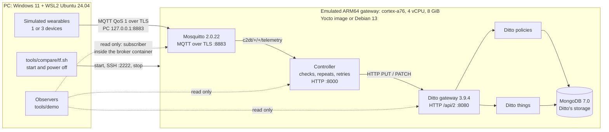

# Architecture

This page shows what was built, how the parts talk to each other and where the code is.
Related pages: the [main README](../README.md), the [demonstration guide](demo.md), the
[results](results.md), [how to reproduce](reproduce.md), and the message formats and interfaces in
[`src/CONTRACTS.md`](../src/CONTRACTS.md) (v1.2).

> Everything runs on an ARM64 computer **emulated** by QEMU (TCG) on an x86-64 PC. The 4 virtual
> CPUs and 8 GiB are emulator settings, not a physical board. Memory limits and timeouts on this
> page are settings read from the code, not measurements.

## 1. Overview

The gateway receives telemetry from wearables over MQTT and keeps one digital twin per device in
Eclipse Ditto. The project's own service is the **controller**: it reads MQTT and writes to Ditto.
Six containers run inside one emulated ARM64 computer.

The observers reach the gateway over SSH. The MQTT observer (`tools/demo/observe/mqtt.sh`) runs a
read-only subscriber inside the broker container; the Ditto observer reads the twins through the Ditto
gateway.

## 2. The PC and the emulated gateway

| Part | What it is | Defined in |
|---|---|---|
| PC | x86-64, Windows 11 with WSL2 Ubuntu 24.04. Runs Terraform, QEMU, the simulator, the observers and the measurement scripts. | [`tools/compare/README.md`](../tools/compare/README.md) |
| Controller image | Built for `linux/arm64` by Docker Desktop on Windows, saved as an archive with an identity record, then loaded into the gateway. Nothing is built on the gateway. | [`build-controller-image.sh`](../src/deployment/scripts/build-controller-image.sh), [`src/Dockerfile`](../src/Dockerfile) |
| Emulator | `qemu-system-aarch64` 8.2.7 from the Yocto build (`qemu-helper-native`). One profile for every configuration: `-machine virt -accel tcg -cpu cortex-a76 -smp 4 -m 8192`. | [`tools/compare/lib.sh`](../tools/compare/lib.sh) |
| Network | QEMU user-mode networking. Only two ports are forwarded: `127.0.0.1:2222` to SSH (22) and `127.0.0.1:8883` to MQTT over TLS (8883). | [`tools/compare/compare_env.sh`](../tools/compare/compare_env.sh) |
| Disks | Root disk: a qcow2 overlay on a checksummed base copy that is never written. Data disk: raw 32 GiB ext4, label `egw-data`, mounted on `/var/lib/docker`. | `tools/compare/README.md` |
| Control | Serial console logged to a file, a QEMU monitor socket (fallback power-off) and a pid file. Only one gateway runs at a time. | `lib.sh`, `compare_env.sh` |

The three configurations (files in [`tools/compare/scenarios/`](../tools/compare/scenarios/)):

| Name | Operating system | Boot | Use |
|---|---|---|---|
| `yocto` | Poky 5.0.19 (Scarthgap), `egw-gateway-image`, `MACHINE=qemuarm64`. Kernel linux-yocto 6.6.142, systemd, BusyBox 1.36.1, docker-moby 25.0.9, Compose v2.26.0. User `egw`, SSH key only. | Direct kernel boot | The project's image, from [`src/yocto/`](../src/yocto/README.md). Measured. |
| `debian13` | Debian 13.8 genericcloud arm64 (20261017-2634). Kernel 6.12.113, docker.io 26.1.5, Compose 2.26.1. Set up once by cloud-init with the same configuration files. | Direct boot of Debian's own kernel and initrd | Baseline for the comparison. Measured. |
| `yoctowrynose` | Poky 6.0.3 (Wrynose), `MACHINE=genericarm64`. Kernel 6.18.39 with initramfs, Docker 29.3.0, Compose 5.1.0. | UEFI (edk2, systemd-boot) | Demonstration only, **not measured**. Built outside this repository; its build files are in an image package kept locally. |

Each scenario file lists the differences that no setting removes.

## 3. Services inside the gateway

The services form the Docker Compose project `egw`
([`src/deployment/compose.yaml`](../src/deployment/compose.yaml)) on one network, `egw-net`. The
five external images are pinned by digest in
[`images.lock.env`](../src/deployment/images.lock.env); the controller image is built locally
(`pull_policy: never`).

| Service | Image | Reachable at | Memory limit | Role |
|---|---|---|---|---|
| `mosquitto` | `eclipse-mosquitto:2.0.22` | `8883` on the gateway (PC: `127.0.0.1:8883`) | 128M | MQTT broker: TLS 1.2, password file and access list, no anonymous clients |
| `controller` | `egw-controller:0.1.0` (`python:3.12.13-slim`, hashed dependency lock) | `127.0.0.1:8000`, inside the gateway only | 256M | From MQTT messages to twin updates |
| `ditto-gateway` | `eclipse/ditto-gateway:3.9.4` | `127.0.0.1:8080`, inside the gateway only | 768M | Ditto HTTP API `/api/2` |
| `ditto-things` | `eclipse/ditto-things:3.9.4` | internal | 768M | The twins |
| `ditto-policies` | `eclipse/ditto-policies:3.9.4` | internal | 768M | The access policy of each twin |
| `mongodb` | `mongo:7.0.39` | internal | 512M | Storage for Ditto's twins and policies |

- Only Ditto's core services run. Search, connectivity, the web UI and nginx do not
  ([`CONTRACTS.md`](../src/CONTRACTS.md) §8).
- The limits add up to 3,200 MiB of the 8 GiB. The header comment of `compose.yaml` still gives an
  older total of 2,432 MiB.
- On the gateway, the deployment lives in `/opt/egw/deployment`.

## 4. The path of one message

Simulator → Mosquitto (MQTT) → controller → Ditto. MongoDB only stores Ditto's data; it does not
carry messages.

1. **Simulator**, on the PC ([`src/egw_simulator/`](../src/egw_simulator/README.md)).
   - Publishes at QoS 1 over TLS as user `egw-simulator`, to `c2dt/{egw_id}/{device_uuid}/telemetry`.
   - Checks every payload against the JSON Schemas before sending it.
   - `message_id` is a UUID v5 of `run_id:device_uuid:seq`.
   - Three device types (smartwatch, smart ring, smart clothing) share a total rate in the ratio
     1 : 0.2 : 10.
2. **Mosquitto.** The access list
   ([`mosquitto/config/acl`](../src/deployment/mosquitto/config/acl)) lets `egw-simulator` only
   write `c2dt/#` and `egw-controller` only read it.
3. **Controller**, in the gateway ([`src/egw_controller/`](../src/egw_controller/README.md)).
   It subscribes to `c2dt/+/+/telemetry` at QoS 1, with a persistent session and manual
   acknowledgement. Each message goes through these steps, in order:
   1. decode the JSON, read the topic, check the schema (draft 2020-12);
   2. check that topic and payload agree and recompute `message_id`; a mismatch is rejected
      without calling Ditto;
   3. on a device's first message, create its policy and then its twin (`PUT`);
   4. ignore repeats: the last 1,024 `message_id`s per device, plus a `seq` floor per `run_id`,
      kept in the twin's `ingestion` feature;
   5. update the twin (`PATCH`, `application/merge-patch+json`);
   6. write one outcome line to `events.jsonl`. Only then is the message acknowledged to the broker.

   - Outcomes: `accepted`, `rejected`, `duplicate`, `failed`.
   - Calls to Ditto are retried only after a timeout, a connection error or a 5xx: 3 attempts,
     back-off from 200 ms, 10 s timeout. A 4xx is never retried.
   - One queue of 10,000 messages, one worker.
   - Latency runs from the controller's reception to Ditto's 2xx, on the controller's clock.
   - HTTP API: `GET /health`, `/ready` (200 only when subscribed and Ditto is reachable),
     `/twins/{device_id}`, `/metrics`.
4. **Ditto.** The gateway service passes requests to the things and policies services, which store
   them in **MongoDB**. For each device, thing id = policy id = `org.c2dta:{device_uuid}`. The
   controller identifies itself with `x-ditto-pre-authenticated: pre:egw-controller`, inside
   `egw-net` only.

## 5. Ports and access

| Port | Listens on | Reached from the PC by |
|---|---|---|
| SSH (22) | the gateway | `127.0.0.1:2222`, user `egw`, key only |
| MQTT over TLS (8883) | `mosquitto` | `127.0.0.1:8883` |
| Controller HTTP (8000), Ditto HTTP (8080) | the gateway's loopback | an SSH tunnel, or `curl` run inside the gateway over SSH (the `tools/demo` observers) |
| MongoDB (27017), Ditto cluster (7626) | `egw-net` only | not reachable |

No other gateway port is forwarded. Starting and stopping go through `tools/compare/tf.sh`:

- `apply` starts the gateway and runs `provision_stack.sh`, which installs and starts the six
  services.
- `stop` runs `docker compose stop -t 60`, then `sudo poweroff` over SSH (the monitor's
  `system_powerdown` as a fallback), and waits up to 180 s for QEMU to end. QEMU is never killed.

Commands: [`tools/compare/README.md`](../tools/compare/README.md); step by step: [demo.md](demo.md).

## 6. Contracts

- [`src/CONTRACTS.md`](../src/CONTRACTS.md) **v1.2** is the reference for MQTT, message formats,
  twins, the controller, settings, ports and metrics. Older pages that cite v1.1 (the controller
  and simulator READMEs, `diagrams/`) give way to it.
- [`src/schemas/`](../src/schemas/): the JSON Schemas, loaded by the controller and the simulator.
  [`src/things/`](../src/things/): one W3C WoT Thing Description per wearable, checked by a test
  but not loaded at run time.
- [`src/deployment/README.md`](../src/deployment/README.md) was written for a native ARM64 server
  that was never used; the services it describes are the ones deployed here.
- The reasons behind the design: [`docs/adr/`](adr/README.md).

## 7. What is not implemented

The gateway covers a limited core of the C2DTA edge gateway: MQTT over TLS with passwords and an
access list, schema checks, removal of repeats, one Ditto twin and policy per device, and MongoDB
storage. Not implemented:

- consumer agents, decentralised identities and verifiable credentials;
- the ledgers (Hyperledger Fabric and the identity ledger);
- decentralised storage of historical data (IPFS);
- device onboarding approved by the owner (the controller creates the policy and twin on a
  device's first valid message);
- Ditto's search, connectivity and web UI.

Function by function: [C2DTA function traceability](academic/c2dta_p0_traceability.md).
Reference drawing (not normative):
[`diagrams/c2dta_five_layer_reference.svg`](../diagrams/c2dta_five_layer_reference.svg).

## 8. Code map

| Folder | What it does | Main files |
|---|---|---|
| [`src/egw_controller/`](../src/egw_controller/) | The controller | `mqtt.py` (session, acknowledgement), `service.py` (the steps above), `dedupe.py`, `ditto.py` (HTTP client, retries), `schema.py`, `topic.py`, `events.py`, `metrics.py`, `app.py` (HTTP API), `config.py` (`EGW_*` settings) |
| [`src/egw_simulator/`](../src/egw_simulator/) | The simulated wearables (3 device types, repeatable from a seed) | `cli.py`, `runner.py`, `publisher.py` (TLS, QoS 1), `devices.py`, `profiles.py`, `envelope.py`, `scenarios.py` |
| [`src/egw_experiments/`](../src/egw_experiments/) | Experiment runner and analysis (`python -m egw_experiments run/analyze/...`) | Used by the comparison: `run.py`, `analyze.py` and the modules they load (`plan_gen.py`, `protocol.py`, `resources.py`, `checksums.py`, `controller_metrics.py`, `environment.py`, `proved_down.py`). The others mainly served earlier test runs. |
| [`src/schemas/`](../src/schemas/), [`src/things/`](../src/things/) | Schemas; Thing Descriptions | see §6 |
| [`src/deployment/`](../src/deployment/) | The six services and their configuration | `compose.yaml`, `images.lock.env`, `.env.example`, `mosquitto/config/`, `scripts/` (TLS, users, checks, controller image build) |
| [`src/yocto/`](../src/yocto/README.md) | Yocto layer `meta-egw` and kas files | Gateway image: `kas/egw-qemuarm64-integrated.yml` (+ `.lock.yml`), `egw-gateway-image.bb`, `scripts/build-profile.sh integrated`. Earlier base image, without containers: `kas/egw-qemuarm64.yml`, `egw-image.bb`, `scripts/build.sh` |
| `src/` (files) | Packaging | `CONTRACTS.md`, `Dockerfile`, `pyproject.toml` (package root), `requirements*.lock` (hashed) |
| [`src/tests/`](../src/tests/) | 62 test modules (pytest), with fake MQTT and Ditto; no broker needed | `test_*.py` |
| `tools/` | See §9 | |
| `.github/workflows/` | Automatic checks | `technical-ci.yml` (tests, checksums, links, JSON, ShellCheck) |
| [`experiments/`](../experiments/README.md) | Manual and output folder of the experiment runner | `README.md`, `results/` |
| [`diagrams/`](../diagrams/README.md) | Earlier diagrams | `architecture.md`, `c2dta_five_layer_reference.*` |

## 9. What each tool folder is for

| Folder | Used for |
|---|---|
| [`tools/compare/`](../tools/compare/README.md) | Starting, checking and powering off each configuration (`tf.sh`, `functional_check.sh`, `scenarios/`), and the comparison measurements (`measure_*`) |
| [`tools/demo/`](../tools/demo/README.md) | The demonstration: menu (`demo.sh`), simulated devices (`wearables/`), observers (`observe/`). It needs nothing from `tools/session/`. |
| [`tools/session/`](../tools/session/README.md) | Scripts that drove the earlier test runs. The comparison measurements also need three of them: `proof_hook_drained.sh` (waits until the controller is quiet), `nominal_account.py` (finds which messages were confirmed late or not at all) and `regen_helpers.py` (writes the helper file the wait uses). Keep this folder where it is. Its README keeps the internal labels of that time. |
| [`tools/probe/`](../tools/probe/README.md), `tools/test/` | A diagnostic of how the broker holds messages while the controller is away; BusyBox test helpers. Not needed to run or measure. |
| `tools/ci/` | Checks run by the automatic workflow (`verify_evidence.py`, `check_markdown_links.py`) |

**Kept but not used for any result.** Nothing was removed. These files stay but played no part in
the results:

- `.github/workflows/manual-arm64-integration.yml`: needs a native ARM64 runner that never existed;
- the `genericarm64` option of `src/yocto/scripts/build-profile.sh`: its kas file is not in the
  repository, so it fails;
- the [set-up guide of a native ARM64 server](history/setup/vm_arm64_hetzner.md) that was never used
  (in the history folder);
- an [earlier deployment drawing](history/diagrams/two_layer_experimental_deployment.svg) (in the
  history folder);
- `src/egw_experiments/campaign.py`: a larger planned experiment that was never run.
